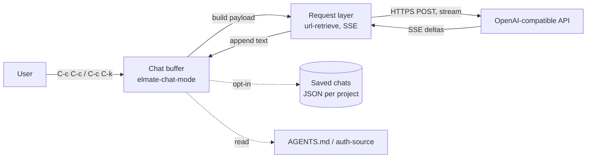

# Elmate Architecture

Elmate is a single-file Emacs package, `elmate.el`. It provides a chat buffer
that talks to an OpenAI-compatible chat-completions endpoint, streams the reply
into the buffer, and renders the transcript as Markdown.

## Components

- **Chat buffer (`elmate-chat-mode`).** A `text-mode` buffer with Markdown
  rendering via `markdown-mode`. It holds the transcript, the editable prompt
  at the bottom, and the state of the current conversation.
- **Request layer.** Builds the JSON payload, sends it with `url-retrieve`, and
  parses the server-sent event stream as it arrives.
- **Persistence (opt-in).** When `elmate-save-chats` is non-nil, histories are
  written as JSON files keyed by project root. Otherwise nothing is stored.
- **Configuration.** `defcustom` variables for the endpoint, model, system
  prompt, AGENTS.md inclusion, and persistence. Credentials come from
  `auth-source`, never from the configuration.

## Conversation Flow

1. The user types after the prompt and sends with `elmate-send`.
2. The prompt text becomes a read-only transcript entry, and a fresh prompt is
   inserted. The buffer is read-only while the request is in flight.
3. The request runs asynchronously. A "Thinking…" indicator shows until the
   first text arrives.
4. Each streamed delta is inserted before the prompt and marked read-only.
5. On completion, the assistant reply is added to the history, editing is
   re-enabled, and the chat is saved if persistence is on.
6. On failure, the request is retried once. A second failure is shown in the
   chat as an error, and the warnings buffer records each attempt.

## Key Design Decisions

- **Single file, minimal dependencies.** Everything lives in `elmate.el`. The
  only external dependency is `markdown-mode`.
- **Buffer-local state.** Each chat buffer owns its history, markers, and
  busy flag. Several chat buffers can exist at once, one per project.
- **Markers, not positions.** The prompt, reply, and indicator positions are
  markers, so they stay correct as the transcript grows.
- **Transcript protection.** Historical text is protected with `read-only`
  text properties. The active prompt is guarded by a read-only overlay, because
  Markdown font-lock rewrites text properties and would otherwise make the
  typed text read-only.
- **Asynchronous streaming.** The UI stays responsive during requests. Only one
  request runs per chat at a time.
- **Opt-in persistence.** Chats are not stored unless the user enables it, since
  saved files contain prompts and replies.

## External Boundaries

- **OpenAI-compatible API.** Any endpoint that accepts the chat-completions
  payload with `stream: true`. The URL is normalised to end in
  `/chat/completions`.
- **`auth-source`.** The API key is looked up by host and user `apikey`.
- **Project context.** The project root comes from `project.el`, or from the
  nearest `AGENTS.md`. The contents of `AGENTS.md` are sent as system context
  when present.

## Testing

`test-elmate.el` is an ERT suite. It covers the chat buffer's editability, the
request and busy-state lifecycle, SSE parsing, URL normalisation, persistence
round-trips, and the working indicator.
